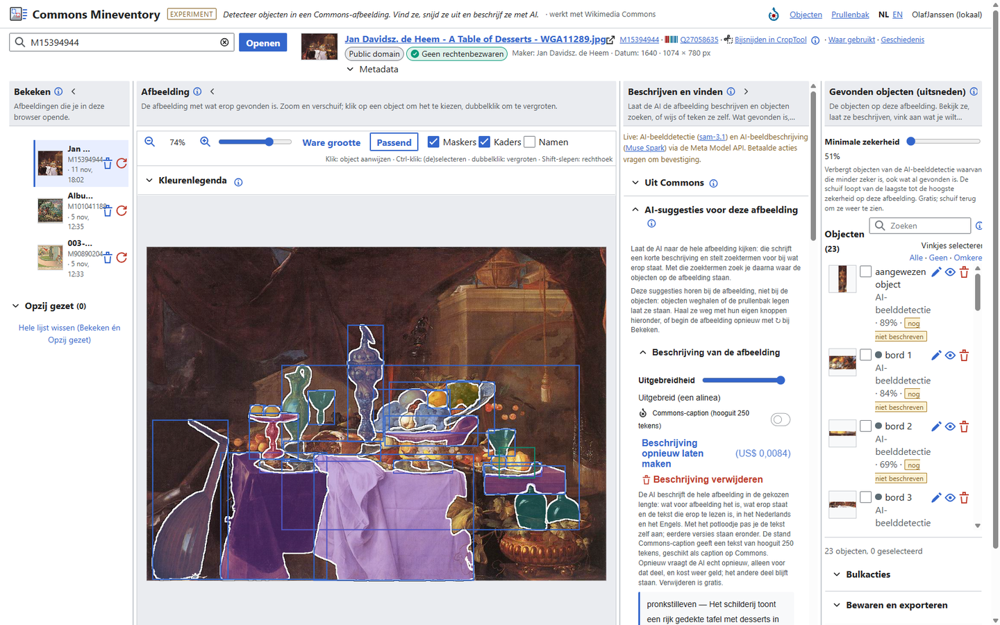
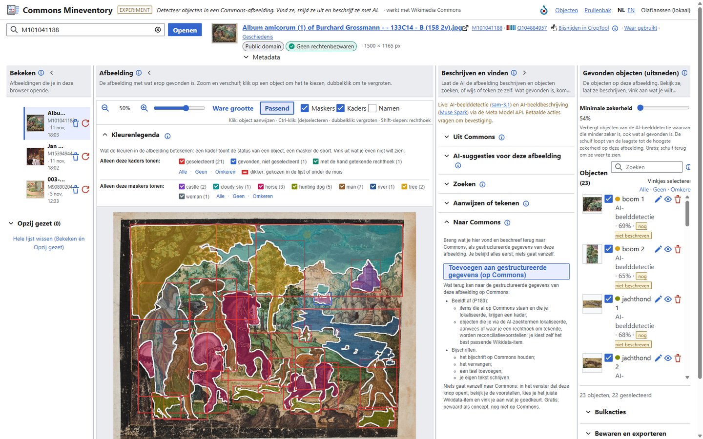
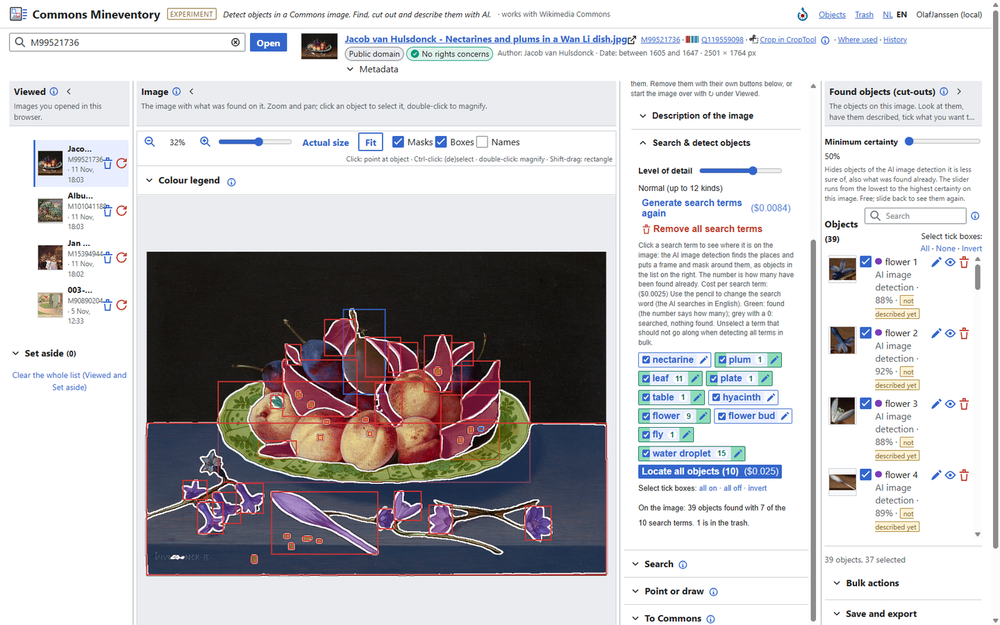
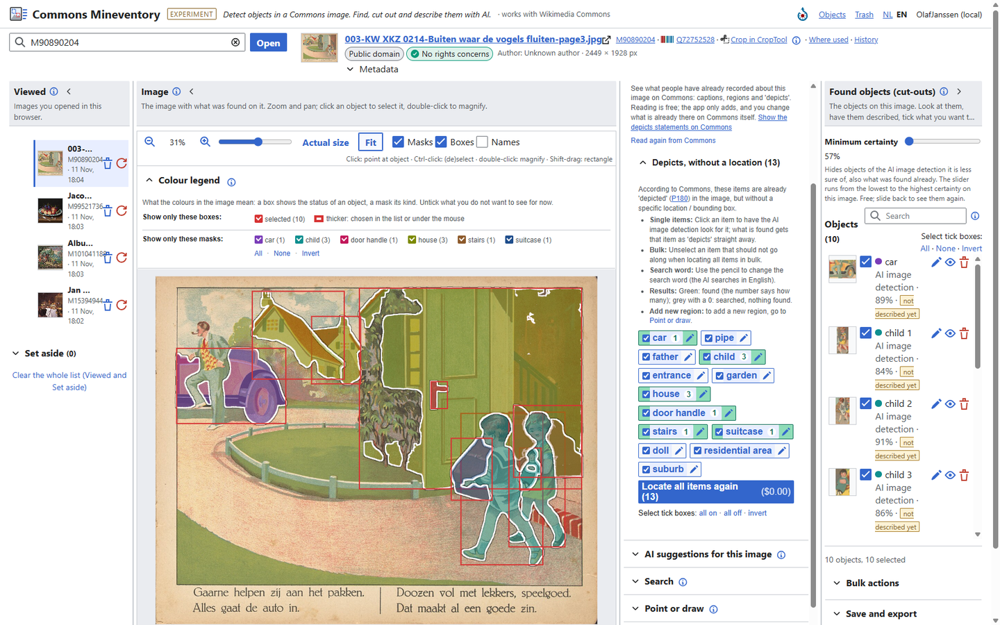
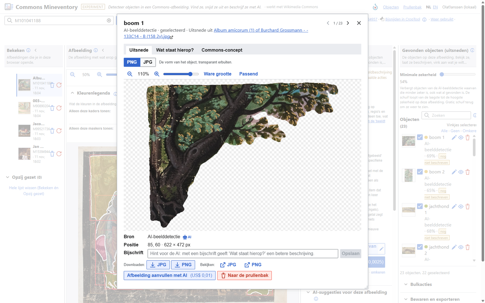
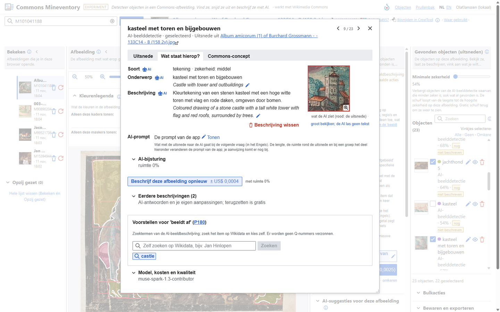
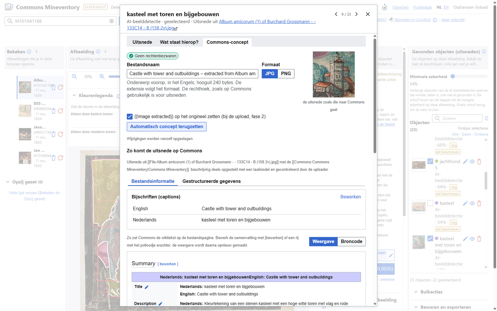
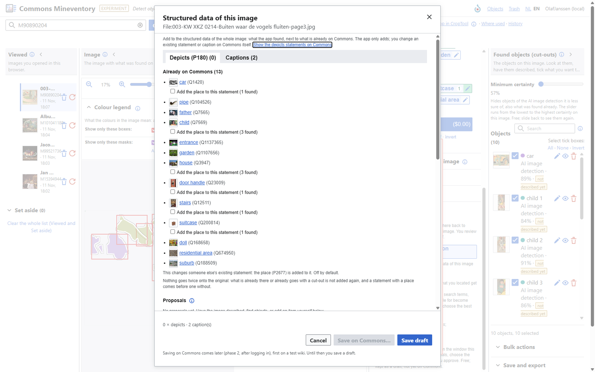
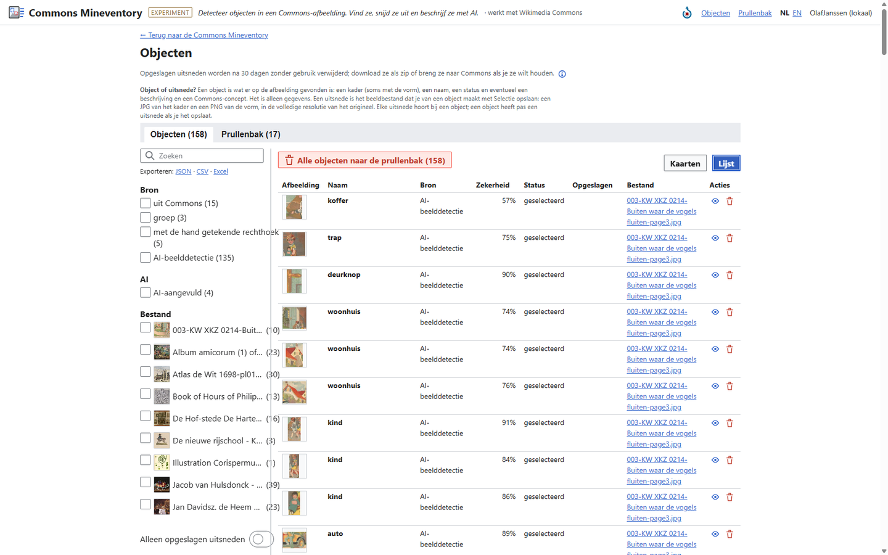
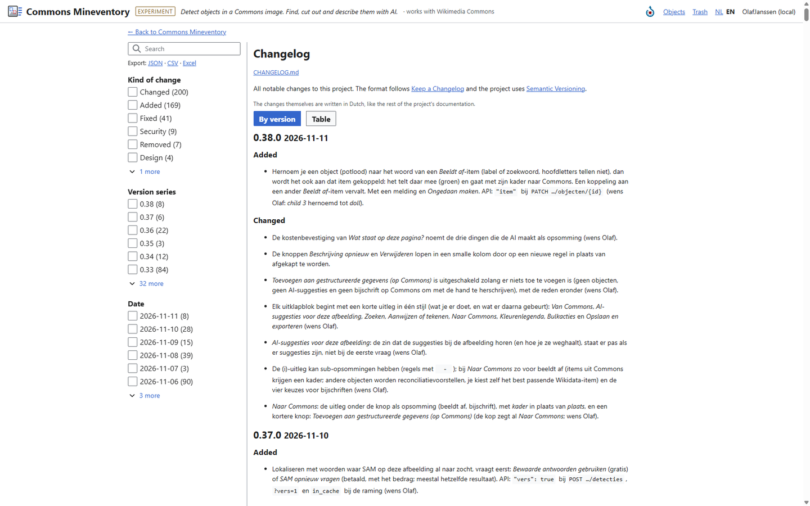

# Commons Mineventory

[](CHANGELOG.md)
[](#status)
[](BACKLOG.md)
[](LICENSE)
[](https://github.com/KBNLwikimedia/commons-mineventory/commits/main)
[](https://kbnlwikimedia.github.io/commons-mineventory/)
<br>
[](https://www.python.org/)
[](https://flask.palletsprojects.com/)
[](https://vuejs.org/)
[](https://doc.wikimedia.org/codex/latest/)
[](https://vite.dev/)
[](https://commons.wikimedia.org/)
[](docs/functioneel-ontwerp.md#6-detectie-en-beschrijving)

<p align="center">
  
</p>

Een experimentele webapp om objecten te vinden in afbeeldingen op [Wikimedia Commons](https://commons.wikimedia.org/), ze uit te snijden als transparante PNG of als JPG, ze te laten beschrijven, en de uitsneden na controle weer op Commons te publiceren, met een koppeling naar het origineel. Een verdieping op [CropTool](https://commons.wikimedia.org/wiki/Commons:CropTool): niet één rechthoek met de hand, maar veel objecten tegelijk, gevonden met AI.

De app is afgeleid van de [Delpher Uitsnijder](https://github.com/ookgezellig/delpher-uitsnijder), die hetzelfde doet voor pagina's uit Delpher.

> **Dit is een experiment.** Het is geen officiële dienst van de KB, nationale bibliotheek, of van de Wikimedia Foundation. Aan deze toepassing kunnen geen rechten worden ontleend.

**Object en uitsnede.** Een *object* is wat er op de afbeelding gevonden is: een kader (soms met de vorm, het masker), een naam, een status en eventueel een beschrijving en een Commons-concept. Het is alleen gegevens, en het wordt bewaard tot de pagina een jaar niet geopend is. Een *uitsnede* is het beeldbestand dat je van een object maakt met *Selectie opslaan*: een JPG van het kader en een PNG van de vorm, in de volledige resolutie van het origineel. Uitsneden worden 30 dagen na het laatste gebruik verwijderd (tenzij ze op Commons staan); het object blijft dan, en opnieuw opslaan maakt de uitsnede opnieuw. Elke uitsnede hoort bij een object; een object heeft pas een uitsnede als je het opslaat. De miniaturen in de lijsten zijn geen uitsneden: die maakt de app telkens even voor het tonen.

## Status

Fase 1 is klaar (versie 0.38.0): alles werkt lokaal behalve inloggen en uploaden. Standaard draait de app met een nagebootste detector en beschrijving (`DETECTIE_MODUS=dummy`, gratis). Met een eigen sleutel van de Meta Model API in `.env` (`MODEL_API_KEY`, `DETECTIE_MODUS=live`) zijn SAM en Muse Spark echt te gebruiken; elke betaalde actie vraagt eerst om bevestiging, met het bedrag. Het ontwerp staat in [docs/functioneel-ontwerp.md](docs/functioneel-ontwerp.md), de API in [docs/api.md](docs/api.md).

## Lokaal draaien

Eenmalig (Python 3.11+ en Node.js):

```
python -m venv .venv
.venv\Scripts\pip install -r requirements.txt
npm install
copy .env.example .env
```

Daarna in twee terminals:

```
flask --app app run --debug
npm run dev
```

en open http://localhost:5000. Zonder `npm run dev` gebruikt Flask de gebouwde bestanden (`npm run build`). Tests: `pytest` en `npm test`.

Opruimen volgens de bewaartermijnen (originelen 7 dagen, uitsneden 30 dagen, detecties en beschrijvingen 1 jaar, telkens vanaf het laatste gebruik): `flask --app app opruimen` telt wat weg zou gaan, `flask --app app opruimen --echt` verwijdert het. Op Toolforge wordt dat een dagelijkse taak.

## Wat de app nu doet

- Een Commons-bestand openen via de URL, de titel of de M-id; ook PDF- en DjVu-pagina's, en originelen boven 100 megapixel (die worden met libvips stuk voor stuk gelezen). Het werkblad heeft vier kolommen in de volgorde van het werk: *Bekeken* (je geopende afbeeldingen, met *Opzij gezet*), *Beeld*, *Beschrijven en vinden* en *Gevonden objecten (uitsneden)*; elke kolom schuift in tot een strook. Op een telefoon zijn de kolommen tabbladen.
- Objecten en maskers detecteren met SAM 3.1 (Meta Model API): zoeken met een zoekterm, AI-suggesties voor de afbeelding (de aangevinkte zoektermen in één keer, met een schuif voor het **detailniveau**: van alleen het hoofdonderwerp tot veel kleine details), Aanwijzen (ook binnen het kader van een ander object). Of zelf een rechthoek tekenen (gratis) en er later een transparante PNG van laten maken. Na elke actie staat de uitkomst in het paneel; met een schuif **minimale zekerheid** verberg je minder zekere vondsten.
- **Kleuren met één betekenis** in de afbeelding: een kader toont de status, een masker de soort object (per zoekterm een kleur, met een stip in de lijst), de rand van een masker is altijd wit. In de *Kleurenlegenda* kies je met vinkjes, met aantallen en *Alle · Geen · Omkeren*, welke kaders en maskers in beeld blijven.
- **Groeperen**, zoals in PowerPoint: van veel kleine objecten (bijvoorbeeld vijftien waterdruppels) één object maken, met één kader en de maskers samen, en weer opheffen. Een groep wordt beschreven aan de hand van zijn objecten.
- **Afbeelding aanvullen met AI** (Muse Image): gaten in een uitsnede laten invullen, bijvoorbeeld waar iets voor het object stond. Apart van de echte uitsnede, met een AI-merkje en een laag die toont wat de AI verzon; nooit als uitsnede naar Commons.
- Regio's overnemen die al op Commons staan (de gele rechthoeken van *beeldt af* met positie, en bestandsnotities), gratis, en elke regio als apart bestand uitsnijden.
- "Wat staat hierop?" en "Wat staat op deze pagina?" met Muse Spark, in het Nederlands en het Engels, ook met de tekst die in het beeld staat. Van de hele afbeelding zijn beschrijving en zoektermen elk apart opnieuw te vragen of te verwijderen; de beschrijving is met de hand aan te passen en houdt *Eerdere beschrijvingen* bij, net als die van een uitsnede. AI-teksten zijn herkenbaar aan een AI-merkje met uitleg, en per veld met de hand aan te passen (met *Ongedaan maken* en *Terug naar de AI-tekst*), ook in een lightbox naast het grote beeld. Met AI-bijsturing (een aanwijzing, meer ruimte rond de uitsnede) stuur je de volgende vraag bij.
- Uitsneden opslaan in volledige resolutie, als JPG (rechthoek) of transparante PNG (vorm), los of als zip; een overzicht van alle uitsneden en een prullenbak (met *Ongedaan maken*). Bij elke opgeslagen uitsnede staat hoe lang die nog bewaard wordt. De vergroter bladert met *Vorige* en *Volgende* door de objecten, en uitsnede en aangevulde versie zijn er te zoomen zoals in de hoofdviewer.
- Een Commons-concept per uitsnede, te bewerken op een weergave zoals de bestandspagina op Commons: tabbladen *Bestandsinformatie* en *Gestructureerde gegevens*, met *Bewerken* en potloodjes. Bestandsnaam, caption en beschrijving (nl/en), datum, maker, inscripties (`{{Inscription}}`), licentie, categorieën, *beeldt af* (zoeken op Wikidata), de waarden van de overgenomen uitspraken, en een voorbeeld van de regio die het origineel zou krijgen. De velden van `{{Artwork}}`, `{{Book}}`, `{{Photograph}}` en `{{Map}}` volgen docs/artwork-velden.md.
- De pagina **Objecten** met facetten (bron, AI-aangevuld, bestand, opgeslagen), ook voor de prullenbak: per bestand een miniatuur met een zoombare weergave die de maskers van de objecten toont, de vergroter op de pagina zelf (voor de prullenbak alleen om te bekijken), en bij een opgeslagen uitsnede *Bestand openen*, *Downloaden* en, lokaal, *Tonen in map*.
- **Beeldt af, zonder regio**: items die op Commons al als *beeldt af* staan, maar zonder plek, laat je door de AI op de afbeelding zoeken, los of allemaal tegelijk. Groen is gevonden. Een woord dat al gezocht is, komt gratis uit de cache; wil je toch een nieuw antwoord, dan kies je *SAM opnieuw vragen*. Hernoem je een object naar het woord van zo'n item, dan wordt het ook aan dat item gekoppeld (met *Ongedaan maken*).
- **Naar Commons**: de gestructureerde gegevens van de hele afbeelding als concept: *beeldt af* met het kader dat je vond, nieuwe objecten als reconciliatievoorstellen (je kiest zelf het Wikidata-item) en bijschriften (houden, vervangen, een taal toevoegen of je eigen tekst). Opslaan op Commons volgt in fase 2.
- **Opnieuw beginnen** met een afbeelding (↻ bij *Bekeken*): alles van die afbeelding weg, met de keuze om de eerdere AI-antwoorden te houden (gratis) of de AI opnieuw te vragen.
- In de bestandskop naast de bestandsnaam het M-id, het Q-id van het werk en kleine links naar *Bijsnijden in CropTool*, *Waar gebruikt* en de *Geschiedenis* op Commons; bij de collectie en locatie het logo van de instelling.
- De pagina's *Objecten*, *Prullenbak*, *Changelog* en *Verbruik* met facetten, zoeken, sorteerbare kolommen, kaarten of een lijst, en exporteren naar JSON, CSV en Excel. Elke keuze (facet, zoekterm, sortering, weergave) staat in het adres, zodat je een link kunt delen.
- Een volledig tweetalige interface (Nederlands en Engels, ook de foutmeldingen en de privacyverklaring) in de stijl van Wikimedia, met [Codex](https://doc.wikimedia.org/codex/latest/) en Vue 3, gebouwd met Vite. De server is Python (Flask); Node.js is alleen nodig om de frontend te bouwen.
- Een RESTful API onder `/api/v1`, met OpenAPI-beschrijving.

## Schermafbeeldingen

Klik op een afbeelding voor de volledige grootte. Alle schermafbeeldingen zijn van 11 november 2026 (versie 0.38.0), uit de live-modus. Alle afbeeldingen zijn van Commons en in het publieke domein. Dezelfde schermen staan als rondleiding op de [projectsite](https://kbnlwikimedia.github.io/commons-mineventory/#rondleiding).

<table>
  <tr>
    <td width="50%"><a href="docs/screenshots/01-werkblad-ai.png"></a><br><sub><b>1. Het werkblad.</b> Bekeken, Beeld, Beschrijven en vinden en Gevonden objecten (uitsneden): 23 objecten met hun maskers op een stilleven, en de AI-beschrijving van de hele afbeelding.</sub></td>
    <td width="50%"><a href="docs/screenshots/02-album-maskers.png"></a><br><sub><b>2. Veel objecten tegelijk.</b> Een blad uit een album amicorum met kaders en maskers; in de kleurenlegenda kies je welke soorten in beeld blijven. Rechts het nieuwe uitklapblok Naar Commons.</sub></td>
  </tr>
  <tr>
    <td width="50%"><a href="docs/screenshots/03-ai-zoektermen.png"></a><br><sub><b>3. AI-zoektermen.</b> De AI stelt zoektermen voor bij de hele afbeelding; per term hoeveel objecten er gevonden zijn (groen), en alles in één keer lokaliseren. Hier in de Engelse interface.</sub></td>
    <td width="50%"><a href="docs/screenshots/04-beeldt-af-lokaliseren.png"></a><br><sub><b>4. Beeldt af, zonder regio.</b> Items die op Commons al als ‘beeldt af’ staan, maar zonder plek: de AI zoekt waar ze op de afbeelding staan. Groen is gevonden; een woord dat al gezocht is, komt gratis uit de cache, of je vraagt SAM opnieuw.</sub></td>
  </tr>
  <tr>
    <td width="50%"><a href="docs/screenshots/05-vergroter.png"></a><br><sub><b>5. De vergroter.</b> De uitsnede in volledige resolutie, als transparante PNG of JPG, met bron, positie, bijschrift en downloaden; bladeren met Vorige en Volgende.</sub></td>
    <td width="50%"><a href="docs/screenshots/06-wat-staat-hierop.png"></a><br><sub><b>6. Wat staat hierop?.</b> Soort, onderwerp en beschrijving in het Nederlands en Engels, met AI-merkjes, eerdere beschrijvingen en voorstellen voor ‘beeldt af’.</sub></td>
  </tr>
  <tr>
    <td width="50%"><a href="docs/screenshots/07-commons-concept.png"></a><br><sub><b>7. Het Commons-concept.</b> Bestandsnaam, formaat, bijschriften en de bestandspagina zoals de uitsnede op Commons komt, met {{Extracted from}} en gestructureerde gegevens.</sub></td>
    <td width="50%"><a href="docs/screenshots/08-naar-commons.png"></a><br><sub><b>8. Naar Commons.</b> De gestructureerde gegevens van de hele afbeelding: items die al op Commons staan krijgen het kader dat je vond, nieuwe objecten worden voorstellen, en bijschriften. Eerst een concept; niets gaat vanzelf naar Commons.</sub></td>
  </tr>
  <tr>
    <td width="50%"><a href="docs/screenshots/09-objecten.png"></a><br><sub><b>9. Objecten.</b> Alle objecten van alle afbeeldingen, met facetten, zoeken, sorteerbare kolommen, kaarten of een lijst, exporteren naar JSON, CSV en Excel, en de prullenbak.</sub></td>
    <td width="50%"><a href="docs/screenshots/10-changelog.png"></a><br><sub><b>10. Changelog en verbruik.</b> De changelog in de app, met facetten op soort wijziging, versie en datum, zoeken en exporteren; de pagina Verbruik werkt net zo.</sub></td>
  </tr>
</table>

## Wat nog komt

- Inloggen met je Commons-account (OAuth 2.0) en een beheerpaneel (fase 2).
- Uitsneden uploaden naar Commons, op je eigen naam, na een overzicht en een bevestiging: met `{{Extracted from}}`, de licentie van het origineel, categorieën en gestructureerde gegevens; eerst op een testwiki (fase 2).
- Draaien op [Wikimedia Toolforge](https://toolforge.org/) (fase 3).
- Regio's terugschrijven naar het origineel, batches over een categorie, en meer (fase 4; zie de [backlog](BACKLOG.md)).

## Documentatie

De projectsite op [kbnlwikimedia.github.io/commons-mineventory](https://kbnlwikimedia.github.io/commons-mineventory/) bundelt de uitleg (Nederlands en Engels), de rondleiding langs de schermen en de documentatie hieronder als webpagina's. De werkende app komt op Wikimedia Toolforge. De site staat in `site/` en wordt bij elke push naar `main` gebouwd door [een GitHub Action](.github/workflows/pages.yml); lokaal: `pip install -r site/requirements.txt` en `python site/build.py` (uitvoer in `_site/`).

- [Functioneel ontwerp](docs/functioneel-ontwerp.md)
- [REST-API](docs/api.md)
- [Privacy (concept)](docs/privacy.md), ook [in het Engels](docs/privacy.en.md)
- [Overdracht](docs/overdracht.md): de stand van zaken en de werkwijze, voor wie het werk overneemt
- [Ontwerp: *Wat staat hierop?* opnieuw indelen](docs/ontwerp-wat-is-dit.md) (voorstel, wacht op akkoord)
- [Backlog](BACKLOG.md)
- [Changelog](CHANGELOG.md)

## Broncode

Staat op GitHub als [KBNLwikimedia/commons-mineventory](https://github.com/KBNLwikimedia/commons-mineventory) en draait straks als `commons-mineventory` op Toolforge. Tot en met 0.31.0 heette het project *Commons Cutter* (`commons-cutter`); het Python-package heet nog `cutter/`.

## Licentie

MIT voor de code. Onderdelen van derden houden hun eigen licentie: Codex (GPL-2.0-or-later), Vue (MIT) en `meta-sam-parser` (SAM License).
